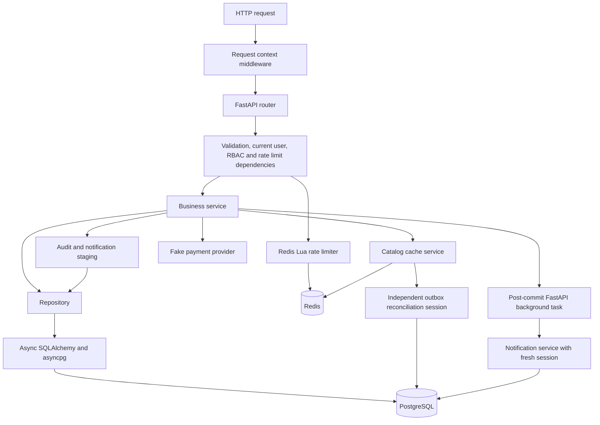

# Architecture

[README](../README.md) · [Database](database-design.md) · [Workflows](business-workflows.md)

OrderFlow is a single FastAPI application with PostgreSQL as the authoritative
store. Redis is a disposable optimization and shared rate-limit coordinator.
There is no separate message broker, worker deployment or production payment
integration in the current repository.

## Components and request path

The common path is **HTTP → router → dependencies → service → repository → async
SQLAlchemy → PostgreSQL**. Dependencies execute as FastAPI resolves a request;
this diagram expresses responsibilities rather than a guaranteed order among
independent dependencies.

## Responsibility boundaries

| Layer | Source | Owns |
| --- | --- | --- |
| HTTP | [api/v1](../app/api/v1/router.py) | Route parameters, schemas, dependency declarations, status codes and domain-error translation |
| Dependencies | [auth](../app/dependencies/auth.py), [permissions](../app/dependencies/permissions.py), [limiter policy](../app/dependencies/rate_limit.py) | Token decoding, active-user lookup, role checks, trusted client identity and admission policy |
| Services | [services](../app/services/order.py) | Business invariants, operation ordering, transaction decisions and post-commit scheduling |
| Repositories | [repositories](../app/repositories/inventory.py) | Queries, row locks, conflict handling, inserts, updates and flushes |
| Models | [models](../app/models/__init__.py) | Mapped tables, relationships, checks, uniqueness and indexes |
| Schemas | [schemas](../app/schemas/order.py) | Pydantic request validation and response serialization |
| Infrastructure | [session](../app/db/session.py), [Redis](../app/core/redis.py), [logging](../app/core/logging.py) | Connection factories, lifecycle and diagnostic policy |

These boundaries are pragmatic: services also issue SQLAlchemy statements for
some locks and reads. This is not an enforced repository-only SQL abstraction.
The payment-provider and notification-delivery protocols are extension points;
the shipped adapters are a fake charge provider and an in-app delivery adapter.

## Session and transaction ownership

[get_db](../app/db/session.py) yields an `AsyncSession` per request dependency.
The first database statement normally begins a transaction through SQLAlchemy
AUTOBEGIN. A successful `flush()` sends SQL and may acquire locks; it does **not**
commit. The dependency closes the session and does not automatically commit a
service's unfinished transaction.

| Operation | Transaction boundary |
| --- | --- |
| Login, refresh, logout mutations | `AuthService._commit_event` commits token changes with the mandatory audit; audit/commit errors roll back |
| Order placement | `OrderService.create_order_from_cart` commits stock, order/items, reservations, notification, cart deletion and audit together |
| Inventory adjustment | Inventory service owns commit/rollback with its audit |
| Catalog mutation | Product/category service rejects explicit or dirty caller transactions, stages invalidation intent, and commits both; recovery runs separately afterward |
| Payment initiation | Service locks the order, calls the provider, persists the payment and commits; a provider call is not part of PostgreSQL atomicity |
| Payment transition | `apply_payment_transition` flushes/stages audit; outer webhook owns commit. The service transition wrapper can commit when `auto_commit=True` |
| Reservation transition | Flushes stock and status only; caller commits or rolls back |
| Webhook | Service commits event and accepted business effects together; selected invalid/quarantined cases deliberately commit diagnostic evidence |
| Shipment create/update | Shipment service owns its commit; shipped/delivered notifications are staged with the update |
| Notification dispatch | Commit a short claim, deliver outside a transaction, then commit a token-fenced finalization |
| Cache reconciliation | Fresh independent session commits claims, does Redis I/O outside locks, then acknowledges with another commit |
| Failed-login audit | Separate bounded best-effort transaction; failure cannot turn invalid credentials into an authentication success |

Repository helpers generally flush rather than commit. Role seeding is a
separate CLI operation that commits newly inserted default roles. Read-only
requests may leave an AUTOBEGIN transaction that closes without business writes.

## Consistency and concurrency

Database row locks serialize conflicting operations under PostgreSQL's ordinary
`READ COMMITTED` isolation; there is no application-wide serializable isolation
setting. Unique/check/FK constraints remain the final arbiter when requests race.

Locking is specific to an operation: user rows for refresh/logout, inventory rows
for stock allocation, orders for payment initiation, and shipment rows for
transitions. Webhook business locking follows **order → payment → ordered
reservations → inventories** after event coordination. See the
[workflow lock table](business-workflows.md#lock-order-and-scope) for scope and limits.

A notification or outbox row staged with a business write survives only if that
business transaction commits. Dispatch and Redis invalidation occur afterward;
no distributed transaction spans PostgreSQL and Redis or an external provider.

## Startup, shutdown and evidence

[main.py](../app/main.py) configures logging and initializes Redis during lifespan,
then closes Redis on shutdown. PostgreSQL sessions connect on demand. API
lifespan does not run migrations. Compose handles migrations through a one-shot
service and starts the API only after that service succeeds.

The test suite supplies independent sessions, real database commits, barriers and
fresh observers. It verifies representative invariants and injected failures;
it does not prove correctness for every arbitrary interleaving. Start with
[test coverage](test-coverage.md), then [operations](operations.md) for execution.
