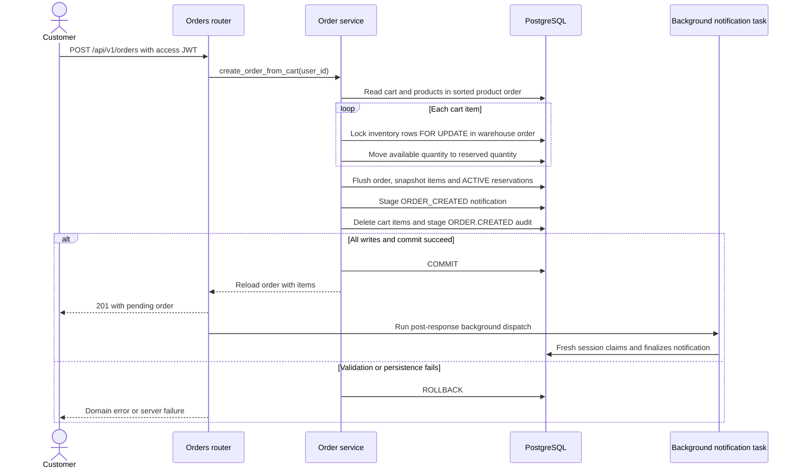
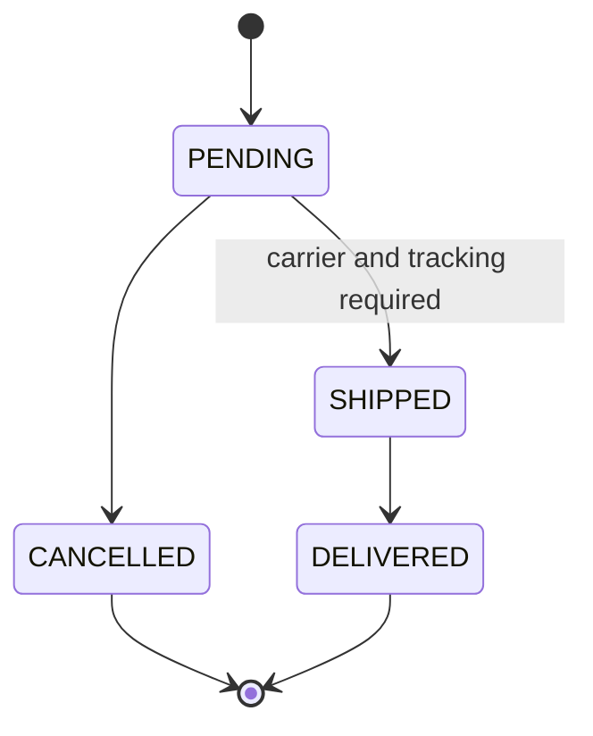

# Business workflows

[Architecture](architecture.md) · [Database](database-design.md) · [API](api-reference.md)

This describes the implementation on `main` after merged PR #28. A service method
is not necessarily an HTTP endpoint; cancellation, expiration and refund support
below must be read with that distinction.

## Authentication

[AuthService](../app/services/auth.py) verifies a user's stored Argon2 hash and
active flag. Login generates an access JWT and a refresh JWT containing a unique
`jti`; it persists the refresh token's identity, user, expiry and revocation flag.
It commits that record with `AUTH.LOGIN_SUCCEEDED` before returning tokens.
Failed credentials/inactive-account login attempt an anonymous, separately
committed, time-bounded audit. Passwords and submitted email addresses are not
accepted as failed-login audit metadata.

[JWT helpers](../app/core/jwt.py) sign with the configured algorithm (default
HS256). Access expiry defaults to 15 minutes and refresh expiry to seven days.
The API verifies the configured signature algorithm and expiry and checks token
type and subject. Each protected request also fetches the user and rejects an
absent/inactive account. A refresh token cannot authorize an access-only route.

### Rotation and concurrent refresh

1. Decode the refresh JWT and validate its type, numeric user subject and string
   `jti`.
2. Fetch the user with PostgreSQL `FOR NO KEY UPDATE`, before reading token state.
   [UserRepository](../app/repositories/user.py) expresses this as
   `with_for_update(key_share=True)` with `read=False` (the default). This is
   **NO KEY UPDATE**, not KEY SHARE; `read=True, key_share=True` would mean the latter.
3. Read the persisted token and verify that its user matches the subject.
4. If already revoked, revoke **all** refresh records for that user, stage
   `AUTH.TOKEN_REUSE_DETECTED`, commit, and reject the request.
5. Otherwise require an active user, revoke the old `jti`, create a new refresh
   identity, stage `AUTH.TOKEN_REFRESHED`, commit and return tokens.

The user lock serializes refresh/logout mutations across that user's tokens and
stays held through commit or rollback. It also avoids competing token-row locks
when replay detection updates all of the user's token records. NO KEY UPDATE
allows PostgreSQL's foreign-key KEY SHARE checks without an unnecessarily strong
key-changing lock. Other users can refresh independently.

Two concurrent uses of the same token do not yield two active descendants: one
rotation succeeds; the second sees revocation and invokes replay revocation,
including the first request's new refresh token. Clients should serialize refresh
requests. Audit failure undoes token changes rather than silently accepting a
security operation with missing mandatory evidence.

### Logout

Logout validates the refresh token, acquires the same user lock, revokes the
specified refresh record and commits `AUTH.LOGOUT`. Repeating logout on a revoked
record returns without another audit. Logout is scoped to that refresh record;
replay detection is the path that revokes all user refresh records.

Access JWTs have no denylist or token version: an already issued access token can
remain valid until expiry after logout or refresh replay revocation. Disabling or
deleting the user still blocks protected requests because the user is reloaded.
See [security assumptions](security-observability.md).

## Order placement

[OrderService](../app/services/order.py) builds an order from the current user's
cart. A cart with no items returns 400. Products must still exist and be active.
Items are sorted by product ID before locks; inventory rows within a product are
ordered by warehouse ID. The service chooses the **first single warehouse row**
with enough available stock for an item. It does not aggregate an item's quantity
across warehouses or optimize fulfillment geography.

The order remains `PENDING`. Items snapshot product name, SKU, unit price and
quantity; later catalog price changes do not rewrite the order's amount. Each
reservation starts `ACTIVE`, with an expiry timestamp 15 minutes from placement.
One commit covers stock movements, order/items, reservations, cart clearing,
notification and audit. Partial stock allocation, an audit insert failure or a
commit rejection rolls all of these back. The losing customer's cart remains
available to retry. Background dispatch is scheduled only after commit.

### Reservation transitions and limits

[InventoryReservationService](../app/services/inventory_reservation.py) locks a
reservation and its inventory row and flushes a transition; the caller owns commit.

| Transition from ACTIVE | Available quantity | Reserved quantity |
| --- | --- | --- |
| CONFIRMED | Unchanged | Decrease by reservation quantity |
| RELEASED | Increase by reservation quantity | Decrease by reservation quantity |
| EXPIRED | Increase by reservation quantity | Decrease by reservation quantity |

Repeating the same terminal target is idempotent. Changing an already terminal
reservation to a different target is rejected. Guards and database checks prevent
negative quantities. There is no expiration scheduler and no public reservation
or order-cancellation endpoint. An expiry timestamp alone does not release stock;
an operator-owned caller must invoke and commit the transition. Shipment
cancellation does not cancel the order or restore its stock.

## Payment creation

[PaymentService](../app/services/payment.py) permits the order owner or ADMIN/
MANAGER. It verifies idempotency compatibility and locks the order before creating
a payment. Amount is calculated from persisted order-item snapshots with Decimal;
the caller cannot supply the charge amount. Currency defaults to INR.

`idempotency_key` is globally unique. Reusing it for the same order/provider
returns the existing payment; a different order/provider is a conflict. The
service and partial unique indexes allow at most one `PENDING` and at most one
`SUCCEEDED` payment per order. A cancelled order or already paid order blocks a
new charge. Only the configured `fake_provider` is currently accepted.

The fake provider derives a stable provider ID from order/key. A key containing
`fail` produces a persisted `FAILED` attempt; one containing `error` simulates a
provider exception, mapped to a sanitized 502 with no new local payment record.
A normal initiation produces `PENDING`, then commits. It does not confirm stock
or the order. A real network charge and local commit would not share a database
transaction; integrating a real provider requires its own idempotency/reconciliation.

## Webhook processing

[Webhook router](../app/api/v1/webhooks.py) bounds the streamed body to
`PAYMENT_WEBHOOK_MAX_BYTES` (default 65,536), checks declared size when valid, and
passes exact raw bytes and `X-Webhook-Signature` to the
[service](../app/services/payment_webhook.py).

1. Verify HMAC-SHA256 using constant-time comparison, then parse/validate JSON.
2. Hash the raw payload. Look up `(provider, provider_event_id)`.
3. A processed matching event is acknowledged without repeating business effects,
   even outside the timestamp window. A reused event ID with different bytes is
   a conflict. Previously unseen/unprocessed events must be within 300 seconds.
4. Lock or insert the event row. Resolve the payment and compare amount/currency.
5. Acquire business locks: order, payment, reservations in deterministic
   product/warehouse/id order, then affected inventory rows.
6. Apply a permitted payment transition, reservation/order changes, audit and
   notification; mark the event `PROCESSED` and commit together.
7. Schedule a notification task only after the successful commit.

Unique event identity handles simultaneous first deliveries; losing inserts
roll back and re-read the winner. Different success events for an already
succeeded payment and confirmed order create no second payment effect. This
provides idempotent **persisted business effects**, with a unique notification
record, rather than an exactly-once guarantee for arbitrary external delivery.

| Event | Result when eligible |
| --- | --- |
| `payment.succeeded` | PENDING payment → SUCCEEDED; all live ACTIVE reservations → CONFIRMED; reserved stock decreases; order → CONFIRMED; payment audit and notification staged |
| `payment.failed` | PENDING payment → FAILED; audit and notification staged; order stays PENDING and reservations stay ACTIVE for another payment attempt |

Failure does not automatically release inventory. A success callback with missing,
expired or non-active reservations rolls back business changes and persists
`RECONCILIATION_REQUIRED` evidence. Unknown payment and amount/currency mismatch
cases persist `FAILED` event diagnostics. Some conflicting transitions reject
and roll back their event attempt. These are deliberately different from a
successful processed replay; repeated invalid/unprocessed events must still meet
the timestamp policy.

Payment service transitions allow PENDING → SUCCEEDED/FAILED and SUCCEEDED →
REFUNDED. FAILED and REFUNDED are terminal. Refund transition support is internal;
there is no public refund route, refund workflow or automatic inventory restoration.

## Shipment lifecycle

[ShipmentService](../app/services/shipment.py) requires a `CONFIRMED` order and a
persisted `SUCCEEDED` payment before creating a shipment. It locks the order and
enforces one shipment per order through a unique constraint. ADMIN/MANAGER may
create, update and list shipments. The owner or staff may read an order's shipment;
other customers receive 404. Shipment reads by ID apply the same ownership rule.

Transitions lock the shipment. SHIPPED records `shipped_at`; DELIVERED preserves
carrier, tracking and shipped time and records `delivered_at`; CANCELLED records
`cancelled_at`. SHIPPED and DELIVERED stage their notification in the same
transaction. A non-null carrier/tracking pair is unique across shipments.
Compatible repeat transitions are idempotent; incompatible tracking changes and
invalid state edges return 409. Shipment transitions leave inventory unchanged.

## Lock order and scope

| Operation | Coordination |
| --- | --- |
| Refresh/logout | User NO KEY UPDATE before refresh-record reads/writes; held through audited commit |
| Order placement | Sorted products; each product's inventory rows FOR UPDATE ordered by warehouse |
| Inventory adjustment | Product/warehouse inventory FOR UPDATE; conflicting first inserts retry after unique violation |
| Reservation transition | Reservation FOR UPDATE, then its inventory FOR UPDATE |
| Payment initiation | Order FOR UPDATE, then payment existence/uniqueness checks |
| Webhook | Event coordination, then order → payment → ordered reservations → inventories |
| Shipment creation/update | Creation locks order; transition locks shipment |
| Notification claim/finalization | Notification FOR UPDATE in separate short transactions |
| Cache recovery | Outbox rows FOR UPDATE SKIP LOCKED; commit claim before Redis I/O |

These are operation-specific protocols, not a blanket promise that all future
operations share one global lock hierarchy. Tests exercise the implemented paths
with independent sessions at READ COMMITTED. See [coverage evidence](test-coverage.md).
