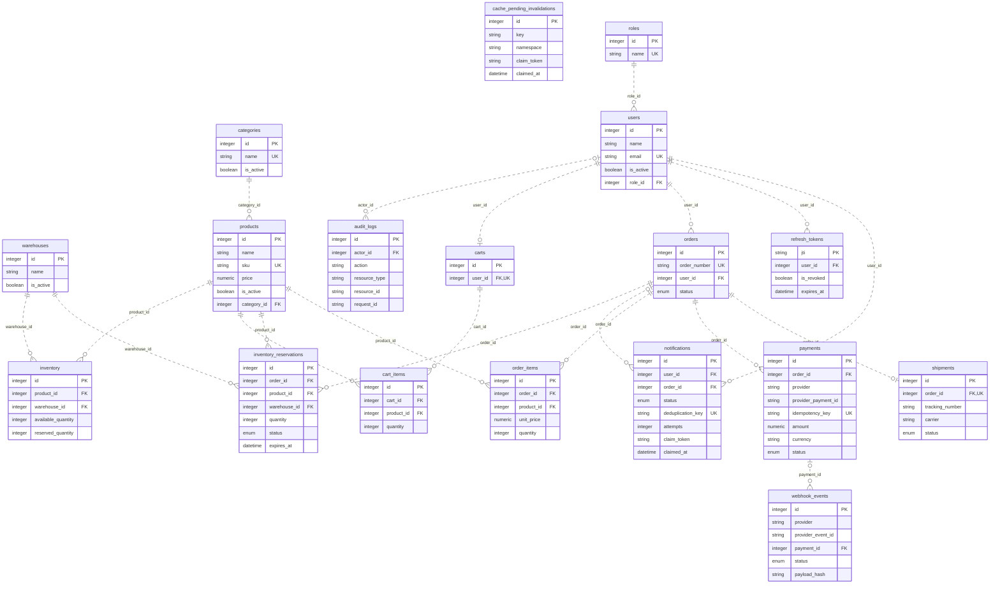

# Database design

[Architecture](architecture.md) · [Workflows](business-workflows.md)

The 18 entities below come from [SQLAlchemy metadata](../app/models/__init__.py).
The diagram shows every table and foreign key with selected business columns;
it omits routine timestamps and some payload fields for readability. `PK`, `FK`
and `UK` mark primary, foreign and single-column unique keys. Optional parent
relationships correspond to nullable foreign keys. Dashed edges are non-identifying
relationships; all entities have their own primary key.

## Entity relationships



`cache_pending_invalidations` is intentionally standalone: it identifies Redis
keys/namespaces and carries claim state, rather than holding a foreign key to a
particular product. Detail keys can remain meaningful after their product is deleted.

## Keys and business constraints

| Table | Important persisted invariants |
| --- | --- |
| roles | Unique role name; role values seeded as ADMIN, MANAGER, CUSTOMER |
| users | Unique email, required role FK, password hash and active flag |
| refresh_tokens | String `jti` primary key, required user FK, revocation and expiry |
| categories | Unique name and slug |
| products | Unique slug and SKU, category FK, nonnegative Numeric(12,2) price |
| warehouses | Unique code; active flag is stored but order allocation does not filter on it |
| inventory | Unique product/warehouse pair; both available and reserved quantities nonnegative |
| carts | Unique user FK: at most one cart per user |
| cart_items | Unique cart/product pair; quantity > 0 |
| orders | Unique generated order number; required owner; status |
| order_items | Quantity > 0 and unit price >= 0; Numeric(10,2) price snapshot, product name and SKU snapshots |
| inventory_reservations | Quantity > 0; unique order/product/warehouse tuple; status and expires_at |
| payments | Globally unique idempotency key; amount >= 0; Numeric(12,2); partial unique indexes described below |
| webhook_events | Unique provider/event-ID pair; nullable payment FK, raw-body SHA-256, processing status and diagnostics |
| shipments | Unique order FK; conditional unique carrier/tracking pair |
| notifications | Unique deduplication key; recipient, optional order, type/channel, status, attempts and claim fields |
| audit_logs | Optional actor FK, action/resource/outcome/request ID, allowlisted JSONB metadata |
| cache_pending_invalidations | Optional key and namespace, plus worker claim token/time; no FK or deduplication constraint |

Status columns use SQLAlchemy `Enum(..., native_enum=False)` string mappings.
Do not assume they are PostgreSQL native enums or that every status transition is
encoded by a database CHECK: state machines are enforced by services. Required
numeric CHECK constraints and uniqueness remain database-level enforcement.

### Important indexes

- Payments have unique `order_id` indexes conditional on status PENDING and on
  status SUCCEEDED. They permit multiple historical failed attempts while
  excluding two concurrent pending charges or two successful payments for one order.
- `(provider, provider_payment_id)` is unique only when the provider ID is non-null.
- Shipment `(carrier, tracking_number)` is unique only when both fields are
  non-null. Order uniqueness is unconditional.
- Audits index `(actor_id, created_at)`, `(resource_type, resource_id, created_at)`
  and `created_at` for actor/resource history and time-range scans.
- Foreign-key lookup columns are generally indexed; orders/payments/shipments
  also index status. Reservations index status and expiry. Outbox rows index key,
  namespace and claimed_at. Inspect model definitions for the complete index set.

## Foreign keys and deletion behavior

The following is generated from mapped FK definitions; `NO ACTION` means there
is no explicit ON DELETE clause. PostgreSQL rejects a referenced deletion unless
the caller first resolves dependents. ORM cascade behavior is a separate layer.

| Child column | References | ON DELETE |
| --- | --- | --- |
| `products.category_id` | `categories.id` | NO ACTION |
| `users.role_id` | `roles.id` | NO ACTION |
| `audit_logs.actor_id` | `users.id` | SET NULL |
| `carts.user_id` | `users.id` | CASCADE |
| `inventory.product_id` | `products.id` | CASCADE |
| `inventory.warehouse_id` | `warehouses.id` | CASCADE |
| `orders.user_id` | `users.id` | RESTRICT |
| `refresh_tokens.user_id` | `users.id` | CASCADE |
| `cart_items.cart_id` | `carts.id` | CASCADE |
| `cart_items.product_id` | `products.id` | CASCADE |
| `inventory_reservations.order_id` | `orders.id` | CASCADE |
| `inventory_reservations.product_id` | `products.id` | RESTRICT |
| `inventory_reservations.warehouse_id` | `warehouses.id` | RESTRICT |
| `notifications.user_id` | `users.id` | CASCADE |
| `notifications.order_id` | `orders.id` | SET NULL |
| `order_items.order_id` | `orders.id` | CASCADE |
| `order_items.product_id` | `products.id` | RESTRICT |
| `payments.order_id` | `orders.id` | RESTRICT |
| `shipments.order_id` | `orders.id` | RESTRICT |
| `webhook_events.payment_id` | `payments.id` | SET NULL |

Audit actor deletion uses SET NULL so the historical action survives. Notifications
and webhook evidence can similarly retain a record after their optional order or
payment reference is removed. Orders, item snapshots and reservations reference
entities with restrictive edges to protect business history. This is not a full
retention/privacy policy: authorized ORM cascades and explicit SQL operations must
still be reviewed, especially because User.orders has ORM delete-orphan cascading.

## Why constraints and validation both exist

Service checks explain errors before writes and choose legal transitions. They
cannot make a read-then-insert race atomic across independent sessions. Unique
indexes close those races, FK constraints reject missing referenced rows, and
quantity/price checks reject invalid direct writes. Row locks serialize updates
to existing stock or business records; constraints also protect inserts where a
row to lock does not yet exist.

Integer stock tracks available and reserved buckets. There is no independent
immutable stock-total column or ledger proving conservation; services and tests
verify movements. Monetary fields use Decimal/Numeric rather than floating-point
arithmetic in persisted payment calculations. Product and payment prices allow a
wider precision than order-item snapshots; unusually large catalog prices can
therefore fail snapshot persistence rather than silently truncate a valid order.

## Schema lifecycle and verification

[Alembic versions](../alembic/versions) define deployment history, ending at
`c27e8a9410bf` (audits). Models define application mappings; tests recreate their
metadata schema. CI separately upgrades an empty `orderflow_migrations` database,
downgrades the latest migration one revision and upgrades again. It does not
exercise every historical downgrade or automatically prove complete model/schema
equivalence. Some historical migration defaults/constraint names differ from ORM
metadata; document semantic guarantees rather than assuming the DDL is identical.

```bash
alembic heads
alembic history
alembic current
```

Use `alembic upgrade head` only against the intended environment. Application
startup does not create tables. See [operations](operations.md) for safe setup and
migration coordination.
